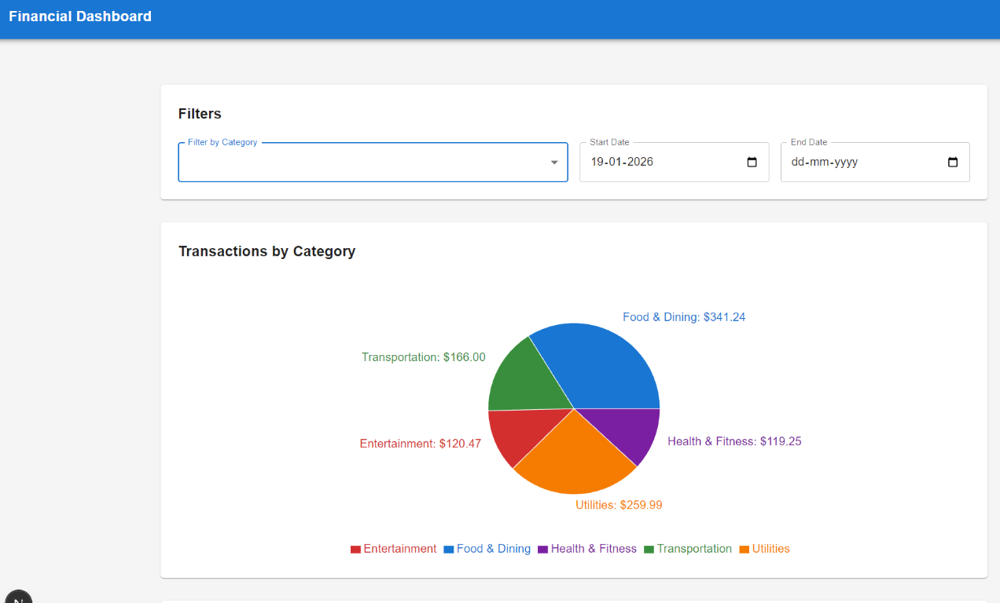
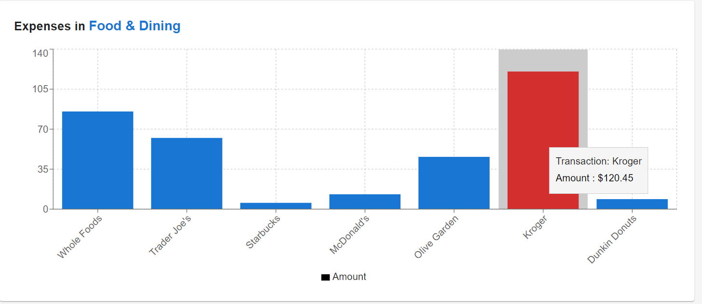

# Financial Dashboard

A modern, full-stack financial management application built with React, TypeScript, Apollo GraphQL, and Node.js. Track transactions, manage categories, and visualize your financial data with an intuitive dashboard.

## Microservice
   - https://github.com/24abhishek84/ms-finance-dashboard
   
## 🚀 Features

- **User Authentication** - Secure login and registration system
- **Transaction Management** - Create, view, and filter transactions
- **Category Management** - Organize transactions by custom categories
- **Dashboard Analytics** - View financial statistics at a glance
  - Total Income
  - Total Expenses
  - Current Balance
  - Transaction Count
- **Data Visualization** - Interactive charts for transaction analysis
  - **Pie Chart** - View expense distribution across categories
    - Click on pie slices to filter and view detailed breakdown
    - Different colors for each category
  - **Bar Chart** - Detailed view of transactions within a category
    - Highest expense highlighted in red
    - Shows transaction names on X-axis
    - Hover to see date and amount details
- **Category Filtering** - Filter by category dropdown or pie chart clicks
- **Date Filtering** - Filter transactions by date range
- **Responsive Design** - Works seamlessly on desktop and mobile devices

## 📋 Project Structure

```
financial-dashboard/
├── packages/
│   ├── frontend/          # React + TypeScript frontend app
│   ├── server/            # Node.js + Apollo GraphQL backend
│   └── common/            # Shared types and utilities
├── README.md              # This file
└── package.json           # Root workspace configuration
```

## 🛠️ Tech Stack

### Frontend
- **React 19** - UI library
- **Next.js 15** - React framework with server-side rendering
- **TypeScript** - Type safety
- **Apollo Client** - GraphQL client
- **Material-UI (MUI)** - Component library and styling
- **Emotion** - CSS-in-JS styling solution
- **Recharts** - Data visualization library

### Backend
- **Node.js** - Runtime
- **Apollo Server 4** - GraphQL server
- **Express** - HTTP framework
- **TypeScript** - Type safety
- **GraphQL** - API query language

### Shared
- **Common Package** - Shared TypeScript types and utilities

## 🚀 Getting Started

### Prerequisites
- Node.js 16+ 
- npm or yarn

### Installation

1. **Clone the repository**
   ```bash
   git clone <repository-url>
   cd financial-dashboard
   ```

2. **Install dependencies** (from root directory)
   ```bash
   npm install
   ```

### Development

Run the entire stack (frontend + backend):

**Terminal 1 - Backend Server:**
```bash
cd packages/server
npm install
npm run build
npm start
```

The server will start at `http://localhost:4000/graphql`

**Terminal 2 - Frontend App:**
```bash
cd packages/frontend
npm start
```

The frontend will open at `http://localhost:3000`

### Building for Production

**Build Backend:**
```bash
cd packages/server
npm run build
npm start
```

**Build Frontend:**
```bash
cd packages/frontend
npm run build
```

## 📝 Available Scripts

### Frontend (`packages/frontend/`)
- `npm start` - Start development server
- `npm test` - Run tests
- `npm run build` - Build for production

### Backend (`packages/server/`)
- `npm start` - Start server in production mode
- `npm run dev` - Start development server (build + start)
- `npm run build` - Compile TypeScript to JavaScript
- `npm run codegen` - Generate GraphQL types

## 🔗 API Endpoints

### GraphQL Endpoint
- **URL:** `http://localhost:4000/graphql`
- **CORS:** Enabled for localhost:3000 and localhost:3001

### Main Queries
- `transactions` - Fetch all transactions
- `categories` - Fetch all categories
- `dashboardStats` - Fetch dashboard statistics

### Main Mutations
- `login(email, password)` - User login
- `register(email, password, firstName, lastName)` - User registration
- `createTransaction(input)` - Create new transaction
- `createCategory(input)` - Create new category

## 📸 Screenshots

### All Transactions
View all expenses at a glance with the interactive pie chart showing expense distribution across categories. Click on any pie slice to filter and explore specific categories in detail.



### Category Specific Transactions
Dive deep into individual categories with the bar chart view, showing all transactions within a selected category. The highest expense is highlighted in red for quick identification.



## 🎨 UI Components

- **Dashboard** - Main dashboard with stats and charts
- **TransactionChart** - Pie chart showing expense distribution by category
  - Interactive slices - click to filter
  - Color-coded by category
  - Hover for amount details
- **CategoryExpensesChart** - Bar chart for category transaction details
  - Shows all transactions in selected category
  - Highest expense highlighted in red
  - Transaction names on X-axis
  - Date visible in tooltip on hover
- **CategoryFilter** - Dropdown to select category for detailed view
- **TransactionList** - List of transactions with filtering
- **Login/Register** - Authentication pages

## 🔐 Authentication

The app uses JWT-based authentication:
- Tokens are stored in localStorage
- User ID is tracked in request headers
- Protected GraphQL queries require valid token

## 🌐 CORS Configuration

Backend CORS is configured to allow:
- `http://localhost:3000` (frontend dev)
- `http://localhost:3001` (alternative frontend)

Credentials are included in all requests.

## 📦 Dependencies

See `package.json` in each package directory for specific versions.

## 🤝 Contributing

1. Create a feature branch
2. Make your changes
3. Test thoroughly
4. Submit a pull request

## 📄 License

This project is licensed under the MIT License.

## 🐛 Troubleshooting

### Backend Connection Error
- Ensure backend is running on port 4000
- Check CORS configuration matches your frontend URL
- Verify GraphQL endpoint: `http://localhost:4000/graphql`

### GraphQL Queries Failing
- Ensure user is authenticated (login first)
- Check browser console for error details
- Verify backend resolvers are implemented

### Styling Issues
- Clear browser cache
- Rebuild frontend: `npm run build`
- Check Tailwind CSS configuration

## 📞 Support

For issues or questions, please check:
- Backend logs (Terminal 1)
- Browser console (F12)
- Network tab in DevTools for GraphQL requests
